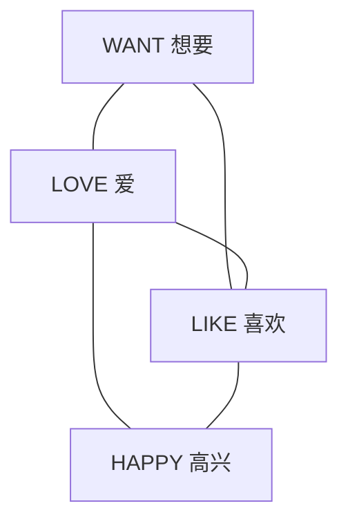

# 两篇 PDF 精读：欲望、喜好、愉悦的地图与构式

日期：2026-11-07。页码均为论文印刷页码；Georgakopoulos & Polis 的 PDF 页码与印刷页码相同；Khanina 的 PDF 第 2 页对应印刷 p. 818。

材料：

1. Georgakopoulos, Thanasis & Stéphane Polis. 2022. *New avenues and challenges in semantic map research (with a case study in the semantic field of emotions).* Zeitschrift für Sprachwissenschaft 41(1): 1–30. [本地 PDF](../../research/ergative/emotionmap2022.pdf)，[DOI](https://doi.org/10.1515/zfs-2021-2039)。
2. Khanina, Olesya. 2008. *How universal is wanting?* Studies in Language 32(4): 818–865. [本地 PDF](../../research/ergative/khanina2008.pdf)，[DOI](https://doi.org/10.1075/sl.32.4.03kha)。

## 1. 结论如何更新

**欲望—喜好／爱—愉悦这一区域已有直接的语义地图。** 2022 年论文不仅包含 WANT—LIKE—LOVE，而且在扩展分析中包含 HAPPY。因此，不能再把“是否存在这几个概念的词汇地图”当作选题的新问题。

但两篇都没有给出“WANT、LIKE、HAPPY 对应的 Experiencer 格依次如何变化”的跨语言地图。对这方面最有用的是将既有的词汇地图与目标语言的构式证据连接起来，并分别记录词项覆盖与语法行为。

需要更正上一次回答：Khanina 关于“不同意义通常对应不同补语策略”的具体讨论，主要针对 WANT 与 THINK／SAY；WANT 与 LIKE／LOVE 的制约条件恰恰记录很少。

## 2. Georgakopoulos & Polis 2022：具体地图

### 2.1 图 7：WANT、LIKE、LOVE 是三角形

§3.1.2–3.2，pp. 9–11。作者从 CLICS3 中抽取表达目标情绪谓词概念的 15,201 个形式，其中 223 个形式表达不止一个目标意义，用它们推导连通图。图 7 加入边权、社群及中心性信息。

与你的题目有关的局部关系可简化为：


这三条边都存在。因此不能从这张图推出“一个词既表达 WANT 又表达 LOVE，就必须表达 LIKE”。两个端点本身有直接连接，不需要中间节点才能连通。

原文 p. 11 给出的权重是 LOVE—WANT 45、LIKE—LOVE 40、LIKE—WANT 17。**这些数不是语言数。** §3.1.1、p. 8 及注 9 说明：地图推导使用动态 utility score，衡量加入一条边能满足多少约束；需要区别于静态的共表达词形数量。它们也不是某一历史变化方向的频数。

[图 7 所在页](../../research/语义地图/emotionmap2022-11.png)。

### 2.2 图 8：两两共表达不等于三义都由同一词表达

§3.3、pp. 11–13。作者使用 formal concept lattice（形式概念格），同时表示概念与具体词项的对应关系。

作者 p. 12 报告：WANT、LIKE、LOVE 两两共表达较常见，但该数据中只有 **Spanish、Selkup、Tsez** 的词项同时覆盖三义。图中分别列出 querer、kikiqa 等具体形式。此处“只有三个”是该数据库的记录，不能解释为全世界只有三种语言具有此现象。

这也是对你的材料编码的提醒：一门语言的 W–L、L–V、W–V 三种配对可能由不同词实现，不能合并成一个“三义词”。记录单位至少应是“点位—词项—意义／构式”。

作者明确给出一个可从格结构计算的数据内蕴含：

> if HOPE and LOVE, then WANT.（p. 12）

意思是：同一词项如果表达 HOPE 与 LOVE，也表达 WANT。这是**词义覆盖的蕴含**，既不是“有希望和爱的人就有欲望”，也不是“某种体验者格必然出现”。其跨语言普遍性需要新材料检验，作者没有在此给出独立样本验证。

[图 8 所在页](../../research/语义地图/emotionmap2022-12.png)。

### 2.3 HAPPY 确实进入了扩展地图

图 7 从动作／过程类情绪概念出发。§4.1–4.3 随后扩大意义范围，纳入性质、实体以及其他相关意义。作者也说明：只限制在预定语义场或词类中，会遗漏重要连接。

图 11a 是更完整的情绪地图。图 11b 去掉 utility score 为 1 的边，拟合度为 95%；图 11c 只保留权重至少为 4 的边，拟合度为 89%（pp. 19–21）。

**图 11c 中四个目标节点的局部子图是：**



这是从原图抽取的无向子图，省略了 HOPE、PROUD 以及外部节点；不是完整地图。WANT 与 HAPPY 之间没有在该筛选子图中保留直接边，但两者可以经 LOVE 或 LIKE 相连。

因此，若仅以这张筛选图提出连通性假设，允许的是“覆盖 WANT 和 HAPPY 的形式还需覆盖 LIKE 或 LOVE 中至少一项”，不能指定必须经过 LIKE。**不过，89% 的整体拟合意味着作者容许一定数量的数据不满足筛选后的地图，这个假设只能作为待检验预测，不能宣称是严格普遍共性。** 稀有边被筛除也不证明相应语言事实不存在。

[图 11c 所在页](../../research/语义地图/emotionmap2022-21.png)，[目标区域放大](../../research/语义地图/emotionmap2022_target.png)。

### 2.4 对五点位比较尤其有用的方法提示

- pp. 17–18：现有词表通常只列原型翻译，并非专门调查词汇多义；因此数据库缺项不能直接解释为该义不存在。
- p. 22：作者明确允许用单一语言资料检验已有地图，也允许有限样本的深入比较；语言内部证据可以补充大样本缺失的信息。
- pp. 22–23：共时共表达与历时变化方向要区分。历时方向需落实到具体词项的历史材料，不能把无向边直接改成箭头。

这些讨论支持你的“查亲属语言补足描述”的做法，但亲属材料首先用于检验家族内部的分布和提出重建假说。仅凭现代意义相同或地图相邻，不能确定祖语义项及变化方向。

## 3. Khanina 2008：调查、制约条件及直接语法证据

### 3.1 它没有构建欲望的语义地图

作者研究 73 种语言、136 个欲望表达（desideratives）；这些表达可以是动词、名词、词缀、小品词或构式。95 个还具有 WANT 之外的其他翻译。心理情绪组中最常见的其他义是 LIKE／LOVE，见于 **32 个表达，而非 32 种语言**（pp. 830–831；附录 10，pp. 860–861）。

作者将 LIKE 和 LOVE 合并，因为来源不足以让她系统地区分两者。故不能把这项计数直接与 2022 年分别编码 LIKE、LOVE 的地图计数等同。

她在 p. 841 明确说，后续必须考察这些其他意义彼此之间的关系，不能只逐一比较 WANT 与其他意义，否则不能建立 semantic map。文中图 1 是样本的地理分布，不是词义地图。

### 3.2 WANT 与 LIKE／LOVE 的制约条件：比上次说的少

§4.1、p. 831：关于 WANT 与 LIKE／LOVE 读法如何分布，资料很少。已知：

| 制约类型 | 作者所列表达 | 出处 |
|---|---|---|
| 完全制约：相关条件能够分开两类解读 | Shipibo-Konibo -kas | p. 831；p. 850 注 16 |
| 部分制约：有些条件排除一义，有些条件仍容许两义 | Shipibo-Konibo keen；Māori piirangi | p. 831；p. 850 注 17 |

作者没有在这里详细列出三者各自的条件；不能据此推断它们一定涉及格交替或某种特定补语类型。其余记录也不能都标为“无制约”：作者在 p. 822 已经明确指出，“无制约”和“没有足够资料”往往无法区分。

同页例 (20) Mupun 表明，WANT 和 LIKE 都可以带活动性内容；例 (21) Chatino 对比“想成长”与“爱孩子”。这说明“事件补语＝WANT、实体补语＝LIKE”不能仅凭后一种对照推广；应分别调查两类意义各自可带的内容。

### 3.3 补语策略差异主要见于 WANT 与 THINK／SAY

§4.2、pp. 831–832。例 (22) Hmong xav 的 WANT 解读使用目的补语标记 kom，THINK 解读使用 hais tias；例 (23) Mapuche pi 的 WANT 解读带名词化补语，SAY 解读带直接引语。这是前一次回答应当准确归属的证据。

即使在这一组中，也不能说每种语言都完全由语法消歧。作者明确指出：常有一种策略只允许一义，而另一种策略仍允许两义。

### 3.4 与原来“作通格＋心理谓词”问题相接的直接例子

§4.3、p. 833，例 (24)：Ingush 同一 lou 在 WANT 与 ACCEPT／TOLERATE 解读下，矩阵参与者分别为 DAT 与 ERG。以下按原文分词、统一缩略语大小写；括号表示可选成分，方括号标出嵌入内容。原文在两例中都将 lou 释为 want，保留这一标注以避免把分析写进词素释义。

**(24a) WANT**

```text
[wa       pirog ja’a-r]      suona   lou.
 2SG.ERG  pie   CL.eat-NMLZ  1SG.DAT want
```

“我想让你吃这个馅饼。”

注意：wa 的 ERG 属于嵌入的“吃”事件；矩阵 WANT 的体验者是 suona “我”，标 DAT，不能把嵌入 ERG 错算成 WANT 的体验者格。

**(24b) ACCEPT／TOLERATE**

```text
cuo(-m)           [shiiga        eanna-r]       lou.
3SG.ERG(-INTENS)   REFL.3SG.ALL  say.PASS-NMLZ want
```

“他接受／容忍别人对他说的任何话。”

原文来源为 Sultan Mereshkov 的个人通讯。这个对照直接显示：同一形式跨心理意义可伴随参与者格变化。但它涉及 WANT—ACCEPT／TOLERATE，不能代替 WANT—LIKE—HAPPY 的证据，也不能据两句就确定整个格框架的全部性质。

缩略语：ALL 向格；CL 类别标记（沿用来源的概括标签）；DAT 与格；ERG 作格；INTENS 强调；NMLZ 名词化；PASS 被动；REFL 反身；SG 单数。

### 3.5 HAPPY 需要额外核实

作者没有将 HAPPY 列为一个独立的高频附加意义。p. 821 例 (7b) Martuthunira 的译文虽然有 “I’ll get happy”，对应结构却含 wiru “feelings” 与“变好”的组合。它不能直接计为 wiru 单词具有 HAPPY 义。

这对你的材料库很重要：区分“同一词根有 WANT 与 HAPPY 两义”和“某个情绪／欲望名词参与一个译为 HAPPY 的复杂构式”。两者都值得比较，但要分列。

### 3.6 理论解释：不能预设跨语言的 WANT、LIKE 是相同的意义原子

§7、pp. 841–844 讨论 macrofunctionality。Khanina 主张：有些表达可能具有一个较宽、未分化的功能，而非先有多个完全独立的义项再发生多义。这是她对 WANT 普遍语义基元地位的质疑的一部分。Goddard & Wierzbicka 2010 对其理论解释提出反驳。

期末论文不必解决这场争论。可以用 WANT、LIKE 等作为比较概念，落实到可辨别的情境与解读；把“共享形式”作为观察结果，而不预先断言它在每一种语言内部都一定属于同一种多义关系。同样，句法行为不同是语言内部分析的重要证据，却不能仅凭形式相同或译词不同就确定词项划分。

## 4. 适合期末论文的研究问题

两篇材料结合起来，最值得继续的不是重新建立同一片词义空间，而是：

> 欲望、喜好与愉悦意义的共表达，是否伴随配价和论元编码的系统分化？

每个词项及其每种构式至少记录：

| 层次 | 必要区分 |
|---|---|
| 意义 | WANT、LIKE、LOVE、HAPPY；不足以区分时单独注明 |
| 内容类型 | 人／物、活动、命题；同一主体／不同主体的事件 |
| 形式关系 | 同一词项、词根共享但有派生、复杂构式、无形式联系 |
| 论元编码 | E 与目标／内容的实际格、后置词、动词索引 |
| 配价与嵌入 | 论元数量、核心／斜格地位、名词化／有限补语／直接引语 |
| 资料状态 | 肯定记录、明确排除、未知；不能把未知记为不存在 |

可以检验三个不同层次的问题：

1. **既有词汇地图的覆盖预测**：共享形式能否跨越 WANT 与 HAPPY 而不覆盖 LIKE／LOVE？这一预测来自筛选后的近似地图，应同时查其稀有例外。
2. **词项内部的构式分化**：同一形式的不同解读是否对应不同配价或格标记？Ingush 给出邻近意义的正例；五点位需要分别查证。
3. **内容类型是否足以解释差异**：例如两种解读都带实体时是否仍有格差异，两者都带事件时是否仍有补语差异？这能避免把“意义效应”与“实体／事件补语效应”混淆。

这里的 1 是词汇覆盖问题，2–3 是语法分布问题；不能把前一张地图直接当作后两项的证据。五点位适合检验这些预测、记录反例及提出局部假说。当前资料尚不足以预先写出 E-DAT／E-ERG 等严格等级。

若继续第 3 题，建议标题：**“欲望、喜好与愉悦表达的构式分化：五种非印欧语言的比较”**。这两篇都主要推进第 3 题；第 1 题中“感知—刺激导向—致使结果”的具体地图问题仍需另查材料。
